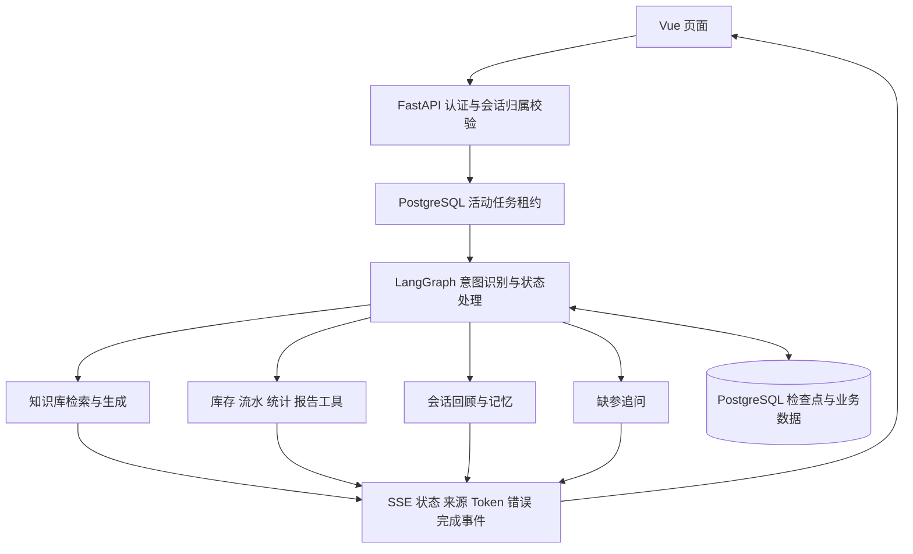
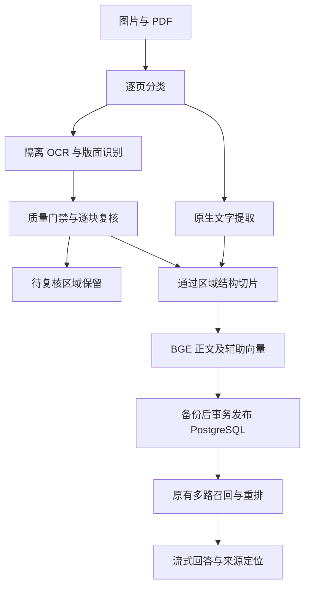

# 半导体智能知识库

Vue + FastAPI + LangGraph 单 Agent 半导体知识库项目，结合 PostgreSQL / pgvector、BGE-M3、多路召回、BGE 重排、外部模型接口，以及图片和扫描 PDF 的 OCR 入库。支持知识问答、材料数据查询与报告、人工咨询和持久化会话记忆。

## 技术栈与实现细节

下表说明各项技术在当前源码中的具体用途。Python 包版本来自 `backend/requirements.lock.txt`；前端表格列出 `package.json` 中的版本约束，精确依赖解析以 `package-lock.json` 为准。依赖已安装不代表相关平台已经接入。

### 前端：Vue、TypeScript 与浏览器流式读取

| 技术 | 版本或形式 | 当前用途 |
|---|---|---|
| Vue | `^3.5.42` | 单页面应用；使用单文件组件与 Composition API 实现登录、聊天、历史会话和工程师工作台 |
| TypeScript | `~6.0.0` | 定义用户、会话、工单和 SSE 请求/事件结构，配合 `vue-tsc` 执行类型检查 |
| Vue Router | `^5.3.1` | 页面导航、登录状态和角色相关访问控制；最终权限仍由后端验证 |
| Pinia | `^4.0.3` | 已注册的状态管理基础；当前业务状态还分布于组件与 API 模块，不能理解为全部已迁入统一 Store |
| Vite | `^8.2.2` | 开发服务、Vue 编译及前端生产构建；开发时代理 `/api` 到 FastAPI |
| Fetch API、ReadableStream、TextDecoder | 浏览器原生 API | 发送带 JSON 请求体的 POST，增量读取与解析 SSE；不是使用原生 `EventSource` 的 GET 订阅 |
| AbortController | 浏览器原生 API | 登录失效或请求取消时中断前端流式读取 |
| markdown-it + DOMPurify | `^15.0.2` / `^3.4.17` | 将回答的 Markdown 渲染为 HTML，再清洗后展示，降低不安全 HTML 的风险 |
| CSS | 自定义主题与组件样式 | 实现深色科技风界面、导航、消息面板和工单状态展示 |

前端请求使用同源 `/api` 路径。JWT 由浏览器携带，前端不从 JavaScript 读取 HttpOnly Cookie；标签页凭证保存在 `sessionStorage`。实现入口：[认证](frontend/src/api/auth.ts)、[流式聊天](frontend/src/api/chat.ts)、[路由](frontend/src/router/index.ts)、[聊天组件](frontend/src/components/ChatBox.vue)。

### 后端：FastAPI 与单 Agent 状态图

| 技术 | 版本 | 当前用途 |
|---|---|---|
| Python | 当前开发环境为 3.14 | 业务 API、检索、文档导入、模型调用和测试 |
| FastAPI + Starlette | `0.143.0` / `1.7.0` | API 路由、依赖注入、认证、异常处理及流式 HTTP 响应 |
| Uvicorn | `0.54.0` | ASGI 服务进程；当前启动脚本采用单 Worker |
| Pydantic | `2.13.5` | 校验和序列化请求、响应及结构化数据 |
| LangGraph | `1.2.12` | 通过 StateGraph 组织意图识别、参数追问、知识问答、数据工具及会话回顾 |
| LangChain Core / OpenAI 适配 | `1.6.5` / `1.1.9` | 消息对象、Prompt 模板、Runnable 组合与模型流式调用；RAG 生成链使用 LCEL |
| HTTPX / HTTPX2 | `0.28.1` / `2.13.1` | 外部模型 HTTP 通信；HTTPX2 用于结构化意图分类客户端 |
| python-dotenv | `1.2.3` | 从本地 `.env` 加载连接、密钥和运行参数 |

当前是**一个 Agent、多个确定的处理分支**，没有多个自主 Agent 互相协作。后端包含同步业务代码；SSE 通过独立生产线程执行整个 `graph.stream()`，队列向响应消费者传递事件，不能描述为全链路异步推理。



实现入口：[服务入口](backend/src/api/main.py)、[API 与 SSE](backend/src/api/routes.py)、[对话图](backend/src/router/conversation_graph.py)。

### RAG 检索：多路召回、RRF 与 BGE 重排

| 环节 | 技术 | 当前实现 |
|---|---|---|
| 查询改写 | LangChain 模型调用 | 结合历史补全指代并生成检索表达，保留设备名、型号、Alarm Code 等信息 |
| 正文向量召回 | BGE-M3、Sentence Transformers、pgvector | 将问题编码为稠密向量，通过 PostgreSQL 向量距离检索正文 Chunk |
| 原文关键词召回 | jieba `0.42.1`、rank-bm25 `0.2.2` | 使用半导体词典分词，在进程内 BM25 索引上匹配关键词 |
| 原问题与改写融合 | 加权 RRF | 合并原始/改写 Query 的 Dense 与 BM25 结果，兼顾词面匹配与语义匹配 |
| 扩展问题召回 | Synthetic Questions 向量 | 检索离线生成的扩展问题，再关联原始 Chunk |
| 增强关键词召回 | Keyword BM25 | 对正文与扩展关键词构建 BM25 检索视图 |
| 候选聚合 | 按 `chunk_id` 去重 | 保存各召回路线的来源及排名，用于计算检索共识 |
| 候选精排 | FlagEmbedding `1.4.2`、BGE-Reranker-v2-m3 | 当前默认先按共识筛选前 20 个候选，再计算 Query-Passage 相关性 |
| 最终排序 | BGE 排名与 Consensus 融合 | 当前权重为 BGE 排名 70%、共识 30%，按融合结果返回 Top K，聊天入口使用 Top 5 |

模型分别为 `BAAI/bge-m3` 和 `BAAI/bge-reranker-v2-m3`；编码使用 `sentence-transformers==6.1.0`，底层为 `torch==2.14.0`。虽然 BGE-M3 本身具有多种表征能力，本项目正文向量路线使用的是其稠密编码，不能据此宣称已使用 BGE-M3 的全部稀疏和多向量功能。

当前混合路线默认取 Top 50，扩展问题和增强关键词路线分别默认取 Top 25，再聚合去重。因此“精排前 Top 20”是候选筛选，不是将整个召回池固定为 20。参数入口见 [V4Rerank](backend/src/rag/v4_rerank.py) 与 [混合检索器](backend/src/rag/rewrite_hybrid_retriever.py)。

### 模型调用、答案生成与审核

- **答案生成、查询改写、会话摘要及报告文本**：使用配置的 DeepSeek 兼容接口，LangChain `ChatOpenAI` 适配及本项目 `BudgetedChatOpenAI` 封装负责调用。模型名称通过 `MODEL_NAME` 配置，源码默认值不保证对应账户一定有可用权限。
- **结构化意图分类**：`typesafe-sdk==0.7.4` 的 `TypeSafeClient` / `Choice` 经 OpenRouter 请求分类结果，区分知识问答、数据查询、报告生成、会话记忆和不明确意图。
- **RAG Prompt**：拼接带编号的证据、来源位置和会话上下文，要求技术结论引用证据；前端在等待 Token 时即可展示来源。
- **引用及覆盖度审核**：项目包含 `CitationVerifier` 与 `AnswerCoverageChecker`。同步 `RAGPipeline.ask()` 接入审核及后续处理；当前聊天使用的 `ask_stream()` 尚未执行同样的完整审核，不应将来源展示等同于审核通过。
- **人工咨询**：支持用户提交问题、工程师接单并回复，回复可以进入会话消息；工程师回复当前不会自动成为经过审批的新知识库文档。

外部模型会接收当前调用所需的问题、检索证据或历史上下文；本地编码和重排不代表答案生成也完全离线。入口：[模型配置](backend/src/config/llm.py)、[意图分类](backend/src/router/intent_classifier.py)、[生成器](backend/src/rag/answer_generator.py)、[RAG 流程](backend/src/rag/rag_pipeline.py)。

### 数据库、业务工具与知识导入

| 组件 | 当前职责 |
|---|---|
| PostgreSQL | 保存用户、登录会话、聊天消息、活动任务、工程师工单、材料业务数据与知识 Chunk |
| pgvector | 保存及检索正文与扩展问题的向量；扩展版本和数据库索引配置不在 Python 依赖快照中 |
| psycopg 3 | `psycopg==3.3.6`，执行参数化 SQL 与事务；核心访问路径采用直接 SQL，不是统一的 ORM 数据层 |
| LangGraph PostgresSaver | `langgraph-checkpoint-postgres==3.1.2`，持久化对话状态、历史消息和摘要进度 |
| LangGraph PostgresStore | 按用户命名空间保存长期资料及偏好 |
| 材料工具 | 通过预定义工具执行库存、流水、期初/期末和出入库统计；报表根据统计结果生成文本，当前不是允许模型自由执行任意 SQL |
| 原生 PDF / Word 解析 | 原生资料兼容入口使用 `pypdf==6.19.0` 与 `python-docx==1.2.0`，分别按 PDF 页和 Word 一级标题进行基础结构切分 |
| 通用加载器 | 另有基于 LangChain Community、docx2txt、python-pptx 的加载实现；不代表主入库入口已经覆盖所有格式 |

原生 PDF 的兼容切分入口保留按页切片，Word 按一级标题分段；新统一导入入口加入 Token 预算和扫描资料的结构化切片。发布前检查源文件哈希并备份知识表，正文、扩展索引和文档版本在一个 PostgreSQL 事务内提交或回滚。同来源的新版本替换该来源的旧切片，文件与解析配置未变化时跳过重复发布。新版本仍有待复核区域时保留旧版。BM25 默认每 5 秒检查发布标记并切换进程内快照；它与数据库查询之间存在刷新间隔，不能描述为所有运行中查询同时原子切换。

入口：[业务工具](backend/src/tools/material_tools.py)、[材料报告](backend/src/reporting/material_report.py)、[主切分流程](backend/src/ingestion/knowledge_base_chunker.py)、[入库脚本](backend/src/database/rag_ingest.py)。

### 图片与扫描 PDF：OCR 解析和可追溯入库

当前实现属于 **OCR 增强的文本 RAG**：图片先被识别为文字和表格，再由 BGE-M3 文本编码。不使用图像嵌入检索，也不自动理解设备结构图、曲线或显微缺陷。

| 环节 | 技术与实际行为 |
|---|---|
| 环境隔离 | 业务后端 Python 3.14；OCR 使用独立 Python 3.11 `.ocr-venv` 子进程，不向原后端安装 Paddle |
| OCR 引擎 | PaddleOCR `3.3.2` / PP-StructureV3、PaddlePaddle CPU `3.2.2`、PaddleX `3.3.13`，依赖锁定在独立 requirements 文件 |
| 页面分类 | pypdf 检查文字质量和图像覆盖情况；原生页直接提取，扫描及大图混合页整页 OCR，空白页跳过 |
| 渲染与图片 | pypdfium2 将 PDF 逐页渲染，默认 180 DPI；Pillow 处理图片、EXIF 方向及透明背景，支持直角方向校正和原页坐标回映 |
| 文字与版面 | PP-OCRv5 mobile 检测和识别文字，版面模型区分标题、正文、表格和图像区域；页眉页脚及边缘页码过滤 |
| 表格 | 解析 HTML 行列及合并单元格，输出结构化行列与 Markdown；保留原表格 HTML，拆片时重复表头 |
| 质量门禁 | 默认块置信度至少 0.85，数字与部分单位所在行低于 0.90 时待复核；检查乱码、异常分隔符、缺失表格结构等。置信度不等于事实准确率 |
| 图示与复核 | 图示、图表和公式进入待复核记录；本地逐块校正文字、表格或补充图示描述，保留复核者、理由、原文哈希和校正审计 |
| 结构切片 | 默认 600 参考 Token，按页面、标题、段落和表格组织，保留来源 SHA-256、页码、块序号、归一化区域坐标和质量状态 |
| 编码与辅助索引 | 每片 1 条正文向量；生成摘要、5 个扩展问题和关键词，摘要与问题另编码成 6 条向量；BGE-M3 1024 维，入库前验证维度与有限数 |
| 受控发布 | 默认只预览；显式 `--publish` 才先执行 pg_dump 并检查备份目录，再事务发布。首次导入可只发布通过门禁的区域，待复核区域不进检索 |
| 缓存与资源 | CPU 两线程，文件串行且跨进程文件锁；逐页缓存可删除，删除不影响数据库问答，但重新解析时需重做 OCR |
| 来源与去重 | 回答来源包含页码、区域和解析方式，前端展示定位；同源配套知识图默认关联 PDF，避免重复入库加权 |



OCR 只在导入资料时执行，日常问答直接检索已入库的文本和向量。OCR 本身在本机运行；摘要、扩展问题和最终回答仍调用配置的外部模型。

文件限制为 100 MB / 1000 页；单页图像上限 2500 万像素，多帧图片需先转逐页 PDF。当前未启用公式、印章或图表语义识别，未实现点击引用高亮原图的浏览器。独立 OCR 进程和版本记录不改变单 Agent 架构，也不等同于完整的企业审批系统。

实现与操作：[OCR 使用说明](backend/docs/ocr_ingestion.md)、[本机验收记录](backend/docs/ocr_ingestion_acceptance.md)、[导入入口](backend/scripts/ingest_documents.py)、[逐块复核](backend/scripts/review_ocr_blocks.py)、[发布事务](backend/src/ingestion/ingestion_publisher.py)、[BM25 快照](backend/src/rag/index_snapshot.py)。验收文档中的本机资料、备份和运行产物不随源码上传。

### 短期记忆、长期记忆与 Token 预算

| 能力 | 机制 | 边界 |
|---|---|---|
| 当前会话历史 | PostgreSQL Checkpointer + 会话标识 | 服务进程退出后可从持久化状态恢复，不依赖单个 Python 进程内的消息列表 |
| 滑动窗口 | 最近消息 + 旧历史摘要 | 默认最近 10 **条消息**，不是 10 轮；预算紧张时进一步压缩旧内容 |
| 增量摘要 | 摘要正文、已处理消息数与历史指纹 | 只摘要新增旧消息，状态随检查点持久化；检测历史变化，空摘要不会推进进度 |
| 长期资料 | 用户命名空间中的结构化 Profile | 明确要求长期保存时写入，合并偏好、型号等字段；普通“记住”仍按当前会话处理 |
| 上下文计数 | `tiktoken==0.14.0`、离线 `cl100k_base` 分词表 | 默认历史上下文预算 4000 参考 Token，保留本轮问题并约束摘要与资料长度 |
| 完整请求预算 | `BudgetedChatOpenAI` | 检查消息、提示、证据和工具描述，并预留输出空间；超限给出明确错误 |

完整请求的默认应用预算为 16384，默认输出上限为 2048，参考输入计数安全系数为 1.15，均可通过配置调整。这些值属于本项目策略，不代表服务商模型的最大上下文容量，也不是精确计费 Token。

滑动窗口只限制发送给模型的内容，不会自动删除数据库中的原始消息。长期资料也不是跨全部历史的向量检索记忆；当前主要是明确保存和读取的用户资料。入口：[上下文管理](backend/src/context/context_manager.py)、[摘要](backend/src/context/summarizer.py)、[请求预算](backend/src/context/request_budget.py)、[长期记忆](backend/src/memory/long_memory.py)。

### 认证、账号隔离与任务生命周期

- **密码**：`pwdlib==0.3.1` 与 Argon2 实现密码哈希，不保存明文密码。
- **JWT**：`PyJWT==2.15.1`，HS256 签名；按登录会话使用独立 HttpOnly Cookie，生产环境启用 Secure 属性。
- **标签页凭证**：随机 Tab Token 保存在当前标签页 `sessionStorage`，服务端保存哈希，并与 JWT、会话 ID、有效期及撤销状态一起验证。
- **CSRF 与来源校验**：修改类请求携带 `X-CSRF-Token`，结合 Origin 白名单；JWT 签名校验不替代 CSRF 校验。
- **会话归属和角色**：聊天会话关联认证用户，工程师接口检查角色；客户端提交的 `user_id` 不是最终可信身份。
- **活动任务租约**：PostgreSQL 原子抢占与定期续租，实现每账号单活动任务；写入检查点、消息及长期资料时再次校验执行权限。
- **退出与断连**：前端 AbortController、后端取消标记、租约监控和上游连接跟踪协同停止任务；正在执行的单个本地张量运算不能保证立即强制中断。

这些机制针对登录、会话及任务权限，不能等同于文档级 ACL、部门数据权限、SSO 或完整安全审计。入口：[认证](backend/src/api/auth.py)、[任务租约](backend/src/api/run_control.py)、[流式取消](backend/src/api/stream_control.py)、[工程师接口](backend/src/api/engineer.py)。

### 推理资源、缓存与 SSE

- 本地 PyTorch 推理使用进程内 `BoundedSemaphore` 控制并发；当前启动脚本设置推理线程数 2、推理并发 1、重排批次 2，并采用单 Worker。
- 编码模型在进程内共享，查询向量使用有界 LRU 缓存，默认容量 512；相同查询与模型键复用计算，正在计算的相同请求等待同一结果。此缓存不缓存完整答案，也不是跨进程共享缓存。
- 模型默认从本地 Hugging Face 缓存加载；首次部署需要先准备完整权重。是否使用 GPU 取决于实际安装的 PyTorch 与硬件，不能仅凭依赖名称判断。重排器在 CUDA 可用时启用 FP16。
- SSE 使用有界事件队列及心跳，传递处理阶段、来源、Token、错误与完成信息；事件队列上限不是全系统排队人数上限。
- 当前后端排障脚本关闭业务执行时限，但认证有效期和租约仍生效；浏览器聊天代码另有 330 秒取消定时器，不能据此宣称端到端无限等待。

入口：[推理资源](backend/src/config/local_inference.py)、[向量缓存](backend/src/embedding/query_vector_cache.py)、[重排批次](backend/src/rag/reranker.py)、[当前启动配置](backend/scripts/start_single_worker.ps1)。

### 评测、自动测试与监控

| 类别 | 当前技术与指标 |
|---|---|
| 检索评测 | 自定义评测脚本，统计候选召回、Recall@1/3/5 和 MRR，比较不同检索方案 |
| 生成质量评测 | `ragas==0.4.3`，包含 Faithfulness、AnswerRelevancy、ContextPrecisionWithoutReference；属于离线评测，不是每次线上回答都会运行 |
| 自动回归 | Python `unittest` 与 Mock，覆盖 SSE、追问、报告范围、向量缓存、记忆和预算等；前端另有 Node.js 测试脚本 |
| 记忆集成测试 | 临时 PostgreSQL schema、独立进程读写及合成事实的真实模型调用；需要对应权限并可能产生接口费用 |
| 负载测试 | `locust==2.46.7`，记录登录、会话创建、认证检查、RAG 完整耗时、TTFT 和 SSE 完成状态 |
| 日志 | Python logging、RotatingFileHandler、请求 ID 与阶段计时；保存后端日志及部分结构化 JSONL 事件 |

当前依赖快照包含 Langfuse、LangSmith 和 OpenTelemetry 相关包，但源码未见完整的统一遥测平台接入，不将其列为已启用监控能力。检索评测中也存在独立实现的历史版本，使用结果前应确认是否与当前 Top 20 筛选及共识融合入口一致。

入口：[检索评测](backend/src/evaluation/)、[RAGAS](backend/src/evaluation/ragas_eval/)、[日志](backend/src/monitoring/rag_monitor.py)、[回归测试](backend/tests/)、[压测](backend/scripts/loadtest_sse.py)。

### 架构范围

当前仓库没有将 Redis、Elasticsearch、独立推理集群、Kubernetes 或多 Agent 调度作为运行前提。开发阶段采用 Windows、本地模型、PostgreSQL 和外部模型 API。HTTPS 反向代理、Windows 服务托管、备份恢复、文档级权限及集中监控仍属于后续部署或完善事项，不能当作本仓库已经交付的生产能力。


## 功能

- 半导体工艺、设备维护、故障排查与规范问答，支持 SSE 输出和来源展示。
- 图片、扫描及混合 PDF 的 OCR 解析、表格提取、质量复核、结构切片和版本化事务入库。
- 当前库存、出入库流水、周期库存统计，以及按材料范围生成周报、月报。
- 工程师待处理队列、人工接单和回复。
- 登录会话、Tab Token、会话历史、短期上下文、增量摘要及长期记忆。
- 检索评测、自动回归与 Locust 压测脚本。

## 目录

```text
backend/                 后端、导入脚本和测试
  src/                   业务源码
  tests/                 自动回归
  scripts/               启动、OCR导入/复核、迁移、记忆测试和压测
  docs/                  OCR操作与本机验收说明
  data/dictionaries/     专业分词词典
  .env.example           配置模板，不含真实凭证
  requirements.lock.txt 当前Windows后端与评测环境的依赖快照
  requirements-ocr*.txt 独立Python 3.11 OCR环境依赖
frontend/                Vue前端及package-lock.json
```

知识库文档、结构化业务数据、评测语料及原文结果、数据库备份、真实配置、日志、模型权重和虚拟环境不随公开源码上传。原项目中的这些文件保持不变。

## 运行前提

当前后端在 Windows、Python 3.14 环境开发。依赖快照包含评测工具，并非最小生产依赖；GPU版PyTorch需按目标硬件另行安装。

前端Node版本要求以 `frontend/package.json` 为准：`^22.18.0 || >=24.12.0`。

需要自行准备：

1. PostgreSQL、pgvector，以及原项目所需业务表、认证表、工单表和知识库数据。此源码快照尚未包含一套可从空库完整初始化的数据库迁移脚本，不能只创建空数据库就运行。
2. DeepSeek与OpenRouter接口配置；模型名称可通过环境变量配置，具体可用性取决于接口账户。
3. `BAAI/bge-m3` 与 `BAAI/bge-reranker-v2-m3` 完整本地模型缓存。默认离线加载；首次准备模型可使用 `LOCAL_MODEL_ALLOW_DOWNLOAD=1`，完成后恢复为0。
4. 需要重新导入资料时，自行放入 `backend/data/knowledge_base/`。导入前先备份数据库，确认路径与已有索引版本，避免生成重复或残留内容。

## 本地启动（PowerShell）

后端：

```powershell
cd backend
python -m venv .venv
.\.venv\Scripts\python.exe -m pip install -r requirements.lock.txt
Copy-Item .env.example .env
```

编辑 `.env`，填写数据库连接、接口密钥和至少32字符的随机JWT密钥。之后准备参考分词表并启动：

```powershell
.\.venv\Scripts\python.exe scripts/setup_context_tokenizer.py
.\.venv\Scripts\python.exe -m uvicorn src.api.main:app --host 127.0.0.1 --port 8000 --workers 1
```

在另一个终端启动前端：

```powershell
cd frontend
npm ci
npm run dev
```

访问 `http://localhost:5173`，前端开发代理将 `/api` 转发到后端。此处为本地开发步骤，正式发布需要HTTPS、静态文件托管、反向代理和服务托管。

## OCR 环境与资料入库（可选）

在 `backend` 目录使用独立 Python 3.11 安装 OCR；不用它替换业务后端的 Python 3.14 环境：

```powershell
.\scripts\setup_ocr.ps1
```

将自有资料放入 `backend/data/knowledge_base/`，先预览：

```powershell
.\.venv\Scripts\python.exe scripts/ingest_documents.py
```

核对输出预览中的切片与待复核项，必要时使用 `scripts/review_ocr_blocks.py` 生成新复核预览。发布前配置可用的 PostgreSQL `pg_dump` 路径（`PG_DUMP_PATH`），再使用实际预览目录：

```powershell
.\.venv\Scripts\python.exe scripts/ingest_documents.py --publish --from-preview 'data/ocr_runs/实际预览目录'
```

`--new-library` 只适用于已放入公开知识来源清单及其 PDF 的本机资料；这些资料未包含在公开仓库中。完整步骤、复核JSON格式和参数见 [OCR使用说明](backend/docs/ocr_ingestion.md)。迁移脚本仅补充OCR版本表，不负责创建项目全部基础业务表。

## 测试

```powershell
cd backend
.\.venv\Scripts\python.exe scripts/setup_context_tokenizer.py
.\.venv\Scripts\python.exe -m unittest discover -s tests -v
```

本机最近一轮完整自动回归为76项，其中24项覆盖新增OCR逻辑；前端类型检查和构建通过。真实扫描资料验收处理了36页，发布54个正文/表格切片；另有18个图示区域仍待复核。这些是本机验收记录，不代表克隆仓库后已包含知识库数据，也不代表全文无损或全量召回率已验证。

额外的PG事务验证可运行 `scripts/test_ocr_publication_pg.py`：它会创建和清理隔离schema，需要相应权限；不应在未理解测试范围时直接对共享生产环境执行。

记忆测试入口为 `scripts/run_memory_suite.py`；先使用 `--help` 查看参数。部分测试会访问真实PG临时schema和外部模型，需配置数据库权限，并可能产生接口费用。

部分根目录测试脚本是历史调试工具，可能与当前认证协议不同；回归入口以 `tests/` 为准。测试通过不代表已经完成生产环境安全、容量或完整知识质量验收。

## 当前运行边界

- 为排障保留业务执行超时关闭的配置；生产环境需要重新确定超时、配额及容量边界。
- 流式问答当前未接入同步流程中的完整引用及覆盖度审核。
- 已具备本地OCR复核与版本化事务发布；文档级权限、完整企业审批及空库初始化迁移仍需补齐。
- 图像输入当前经OCR转换成文本；没有图像向量检索，图示的视觉关系尚不自动参与回答。
- Token预算采用参考编码加安全余量，不等于DeepSeek精确计费Token。
